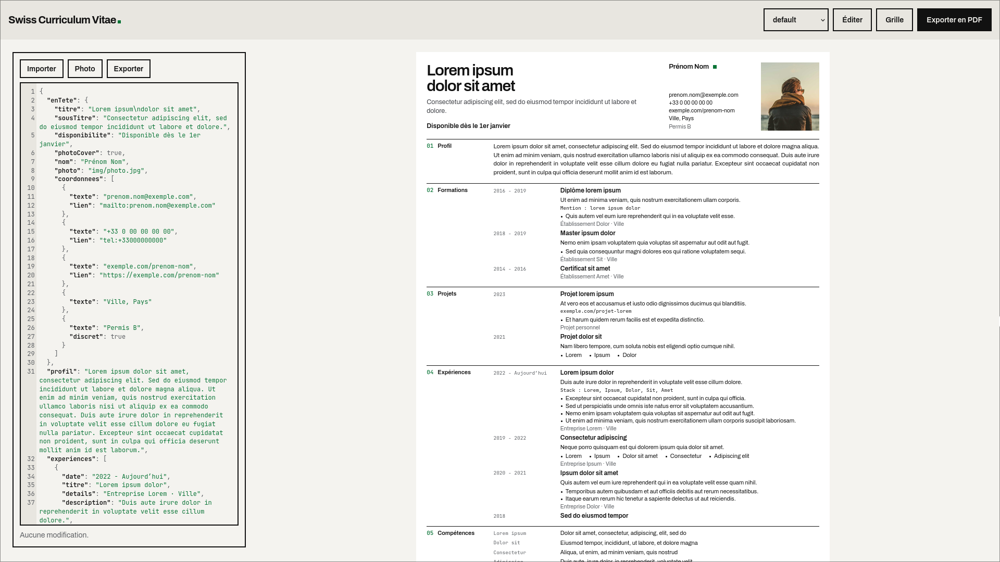
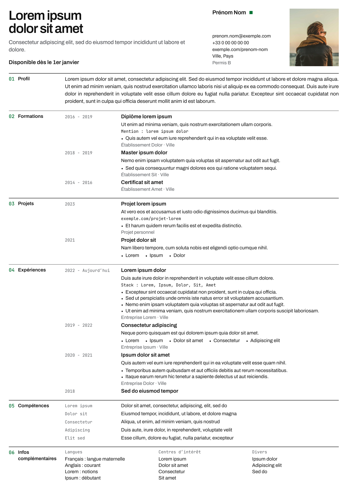

# Swiss Curriculum Vitae

Un CV en une page A4, écrit en Vue et Tailwind CSS. Le contenu vient d'un fichier JSON, modifiable directement dans le navigateur, et l'export PDF se fait depuis le navigateur.

## Interface

La barre du haut permet de choisir la candidature à afficher, d'ouvrir l'éditeur, d'afficher la grille de 12 colonnes et d'exporter en PDF.



## Résultat

Le PDF exporté garde le texte sélectionnable, sauf la numérotation des sections.

[Voir le PDF](docs/default.pdf)



## Utilisation

```sh
cd src
pnpm install
pnpm dev
```

Chaque fichier de `src/src/candidatures/` est une candidature au format JSON. `default.json` sert de modèle, et la forme attendue est décrite dans `src/src/types.ts`. La candidature affichée se choisit dans la barre du haut ou avec `?cv=nom-du-fichier` dans l'adresse.

## Édition en ligne

Le bouton **Éditer** ouvre un panneau avec le JSON du CV. L'aperçu se met à jour à chaque frappe, et une erreur s'affiche si le JSON est invalide ou ne respecte pas la structure attendue.

- Les modifications sont enregistrées dans le navigateur (`localStorage`), par candidature. Elles ne quittent pas votre appareil.
- **Exporter** télécharge le JSON, **Importer** en charge un. C'est la sauvegarde à garder, car vider les données du navigateur efface les modifications.
- **Réinitialiser** revient à la version du fichier du projet.
